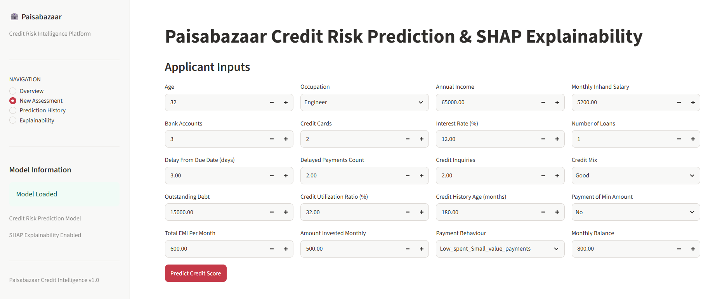
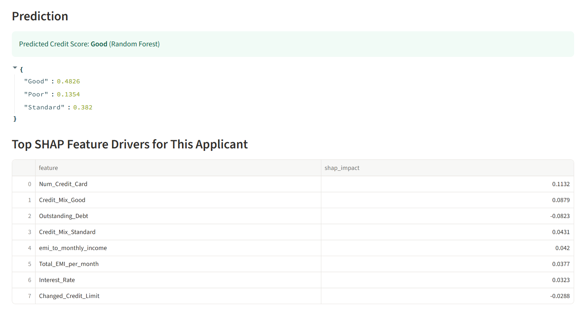
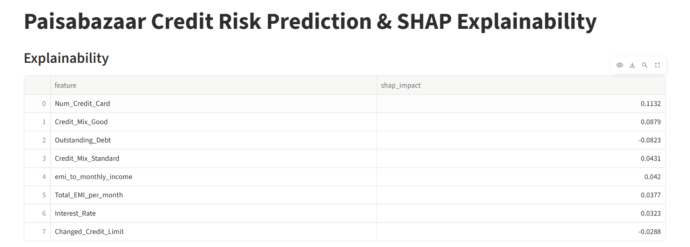
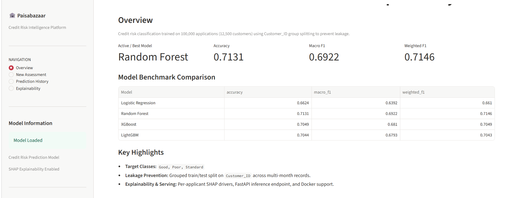
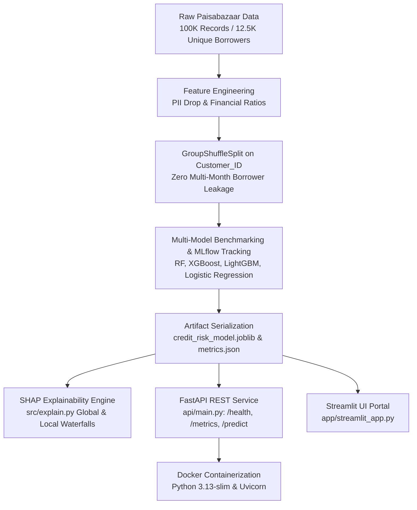

# 💳 Paisabazaar Credit Risk & Fraud ML Pipeline

[](https://paisabazaar-credit-risk-ml.streamlit.app)
[](https://github.com/Ujwal-Bamb/EDA-project-paisabazaar.git)


> **End-to-End Credit Default Risk Prediction & Explainability Platform** trained on 100,000 credit applications. Engineered with group-aware leakage prevention, MLflow experiment tracking, SHAP interpretability, FastAPI microservice endpoints, and a Streamlit production interface.

---

## 🔗 Live Application & Repository

- **Live Application**: [https://paisabazaar-credit-risk-ml.streamlit.app](https://paisabazaar-credit-risk-ml.streamlit.app)
- **Source Code**: [https://github.com/Ujwal-Bamb/EDA-project-paisabazaar.git](https://github.com/Ujwal-Bamb/EDA-project-paisabazaar.git)

---

## 📸 Screenshots

> *Add your application screenshots to `docs/screenshots/` using the exact paths below to render them automatically:*

| Interactive Risk Scoring UI | SHAP Local Waterfall Explanation |
| :---: | :---: |
|  |  |
| *Applicant risk parameter input & credit tier gauge* | *Feature-level contribution to individual credit risk* |

| FastAPI Swagger Documentation (`/docs`) | Model Performance & Confusion Matrix |
| :---: | :---: |
|  |  |
| *Production REST endpoints (`/health`, `/metrics`, `/predict`)* | *Benchmark evaluation across trained classifiers* |

---

## 🎯 Executive Overview & Problem Statement

Financial lending institutions face significant credit default risk and non-performing asset (NPA) losses when customer evaluation relies on manual reviews or crude credit scores. Assessing an applicant's true risk profile requires multi-dimensional analysis across income stability, debt service ratios, historical payment delays, and cash flow margins.

This project delivers an enterprise-grade machine learning system trained on the **Paisabazaar Banking dataset** (100,000 credit applications across 28 features representing 12,500 unique customers). It automates borrower risk classification (`Good`, `Standard`, `Poor`), enforces zero-leakage cross-validation, exposes real-time REST inference via FastAPI, provides model transparency via SHAP values, and deploys an interactive Streamlit assessment portal.

---

## 🏗️ System Architecture



---

## 🔬 Key Engineering & ML Highlights

### 1. Leakage-Free Grouped Validation
- **Multi-Month Record Linkage**: The dataset includes 8 monthly snapshots per customer. Standard random train-test splits cause severe target leakage because historical records from the same borrower bleed across train and test sets.
- **Solution**: Implemented `GroupShuffleSplit(n_splits=1, test_size=0.2, random_state=42)` grouped strictly on `Customer_ID`. Every borrower's historical trajectory remains strictly isolated within either training or test sets.

### 2. Domain-Specific Feature Engineering (`src/features.py`)
Personal identifiers (`SSN`, `Name`, `ID`, `Customer_ID`) are automatically dropped to enforce data privacy. Five core financial risk ratios are computed:
- **EMI-to-Monthly-Income Ratio**: `Total_EMI_per_month / Monthly_Inhand_Salary`
- **Debt-to-Annual-Income Ratio**: `Outstanding_Debt / Annual_Income`
- **Investment-to-Income Ratio**: `Amount_invested_monthly / Monthly_Inhand_Salary`
- **Estimated Net Cashflow**: `Monthly_Inhand_Salary - Total_EMI_per_month - Amount_invested_monthly`
- **Debt-per-Loan Ratio**: `Outstanding_Debt / Num_of_Loan`

### 3. Model Benchmark & Evaluation Results
Four classifier pipelines were trained with median numerical imputation, standard scaling, and one-hot encoding, tracked via **MLflow** (`mlflow.db`):

| Model | Accuracy | Macro F1-Score | Weighted F1-Score | Status |
| :--- | :---: | :---: | :---: | :---: |
| **Random Forest Classifier** | **0.7131** | **0.6922** | **0.7146** | **Selected Best Model** |
| **XGBoost Classifier** | 0.7049 | 0.6810 | 0.7049 | Evaluated |
| **LightGBM Classifier** | 0.7044 | 0.6793 | 0.7043 | Evaluated |
| **Logistic Regression** | 0.6624 | 0.6392 | 0.6610 | Baseline |

*Metrics source: `artifacts/metrics.json` generated from out-of-sample group test sets.*

### 4. Explainable AI with SHAP (`src/explain.py`)
- **Global Feature Importance**: Highlights primary systemic drivers of borrower credit risk (Outstanding Debt, Delay from due date, Interest Rate, and Credit Mix).
- **Local Waterfall Explanations**: Quantifies positive and negative forces driving any individual applicant's prediction into `Good`, `Standard`, or `Poor` credit tiers.

---

## ⚡ FastAPI Production Endpoints (`api/main.py`)

- `GET /health`: Service health check and uptime status.
- `GET /metrics`: Returns evaluation metrics (`accuracy`, `macro_f1`, `weighted_f1`) directly from `artifacts/metrics.json`.
- `POST /predict`: Accepts single or batch credit application payloads and returns predicted credit tiers, class probabilities, and risk levels.

### Sample Request Payload (`POST /predict`)
```json
{
  "applications": [
    {
      "Month": 1,
      "Age": 32,
      "Occupation": "Engineer",
      "Annual_Income": 85000.0,
      "Monthly_Inhand_Salary": 6500.0,
      "Num_Bank_Accounts": 3,
      "Num_Credit_Card": 2,
      "Interest_Rate": 10.5,
      "Num_of_Loan": 1,
      "Delay_from_due_date": 2.0,
      "Num_of_Delayed_Payment": 1.0,
      "Changed_Credit_Limit": 5.0,
      "Num_Credit_Inquiries": 2.0,
      "Credit_Mix": "Good",
      "Outstanding_Debt": 12000.0,
      "Credit_Utilization_Ratio": 28.5,
      "Credit_History_Age": 180.0,
      "Payment_of_Min_Amount": "No",
      "Total_EMI_per_month": 500.0,
      "Amount_invested_monthly": 800.0,
      "Payment_Behaviour": "High_spent_Medium_value_payments",
      "Monthly_Balance": 1200.0
    }
  ]
}
```

---

## 📁 Repository Structure

```
EDA-project-paisabazaar/
├── api/
│   ├── __init__.py
│   └── main.py                     # FastAPI REST API endpoints (/health, /metrics, /predict)
├── app/
│   └── streamlit_app.py            # Streamlit interactive UI with dynamic SHAP force plots
├── artifacts/
│   ├── credit_risk_model.joblib    # Serialized best model pipeline (Random Forest)
│   └── metrics.json                # Persisted validation benchmark metrics
├── data/
│   └── dataset.csv                 # Cleaned dataset sample (100,000 records)
├── docs/
│   └── screenshots/                # Application UI & documentation screenshot placeholders
│       ├── streamlit_app.png
│       ├── shap_waterfall.png
│       ├── fastapi_swagger.png
│       └── metrics_evaluation.png
├── src/
│   ├── __init__.py
│   ├── config.py                   # Global column mappings, feature definitions & paths
│   ├── explain.py                  # SHAP TreeExplainer & visualization utilities
│   ├── features.py                 # PII removal, financial ratio creation & GroupSplit
│   ├── predict.py                  # Predictor class loading joblib pipeline
│   └── train.py                    # Multi-model training pipeline with MLflow logging
├── tests/
│   ├── __init__.py
│   └── test_api_and_model.py       # Pytest suite verifying PII drop, ratios & API routes
├── .dockerignore
├── Dockerfile                      # Production container deployment config
├── mlflow.db                       # Local MLflow SQLite tracking store
├── pyproject.toml                  # Project metadata and tooling config
├── requirements.txt                # Pinned production dependencies
└── README.md                       # Comprehensive documentation
```

---

## 🚀 Local Installation & Execution

### 1. Clone & Set Up Environment
```bash
git clone https://github.com/Ujwal-Bamb/EDA-project-paisabazaar.git
cd EDA-project-paisabazaar

# Create and activate virtual environment
python -m venv venv
# Windows:
.\venv\Scripts\activate
# Linux/macOS:
source venv/bin/activate

# Install dependencies
pip install -r requirements.txt
```

### 2. Retrain Pipeline (Optional)
```bash
python -m src.train
```

### 3. Run FastAPI Inference Service
```bash
uvicorn api.main:app --reload --host 0.0.0.0 --port 8000
```
- Interactive Swagger UI: `http://localhost:8000/docs`
- Redoc Documentation: `http://localhost:8000/redoc`

### 4. Run Streamlit Web Application
```bash
streamlit run app/streamlit_app.py
```
Access the dashboard at `http://localhost:8501`.

### 5. Run Test Suite
```bash
pytest tests/ -v
```

---

## 🐳 Docker Deployment

Build and run the containerized FastAPI service:

```bash
# Build Docker image
docker build -t paisabazaar-credit-risk-api .

# Run container
docker run -d -p 8000:8000 --name credit-risk-service paisabazaar-credit-risk-api

# Check logs
docker logs -f credit-risk-service
```

---

## 👤 Author & Contact

**Ujwal Bamb**  
- **Email**: [ujwalbamb2000@gmail.com](mailto:ujwalbamb2000@gmail.com)  
- **LinkedIn**: [linkedin.com/in/ujwal-bamb-276b04330](https://www.linkedin.com/in/ujwal-bamb-276b04330)  
- **GitHub**: [@Ujwal-Bamb](https://github.com/Ujwal-Bamb)  
- **Credentials**: MeitY-NASSCOM Gold Certified (96/100, NSQF Level 5, ID: FSP/2026/11/10520719) | Master of Computer Science in AI & ML, Woolf University (Jan 2025 - Present) | B.Pharm (SPPU)
